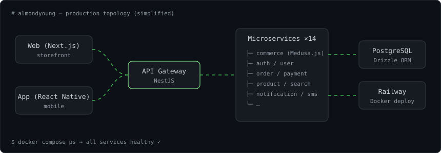

<div align="center">



<br/>

[](https://jungsikjeong.github.io/)
[](mailto:wndtlr1024@gmail.com)
[](https://github.com/nookbox)
[](https://github.com/LCNINE)

</div>

---

### `$ man kong`

```yaml
name:      정중식 (Kong)
role:      Full-stack Engineer @ LCNINE — 아몬드영
since:     2024.09
focus:     frontend-leaning, ships end-to-end
path:      non-CS → self-taught → production MSA
side:      Kong Studio · nookbox (OIDC IdP, side projects)
```

### `$ ls ./stack`

<p>
  
  &nbsp;&nbsp;
  
  &nbsp;&nbsp;
  
</p>

| layer      | tools                                                         |
| ---------- | ------------------------------------------------------------- |
| `frontend` | TypeScript · React · Next.js · React Native (Expo)            |
| `backend`  | NestJS (microservices) · Medusa.js · Drizzle ORM · PostgreSQL |
| `infra`    | Docker · Railway · GitHub Actions · self-hosted Mac mini      |
| `learning` | OIDC / Auth · Three.js · Unity · Blender · Algorithms         |

### `$ cat ./architecture.svg`

> 아몬드영 백엔드를 굴리는 구조 — 11~14개 서비스로 쪼갠 NestJS MSA



### `$ git log --oneline --projects`

```diff
+ almondyoung-server   NestJS MSA + Medusa.js 커머스 백엔드
+ almondyoung-app      React Native 앱 (출시 준비 중)
+ nookbox/idp          직접 만드는 OIDC Identity Provider
+ smspublish           안드로이드 폰을 SMS 게이트웨이로 쓰는 마케팅 자동화
+ kong-studio          웹 · 모바일 · 소크팝 스타일 게임 인디 스튜디오
```

### `$ ./activity --graph`

<picture>
  <source media="(prefers-color-scheme: dark)" srcset="https://raw.githubusercontent.com/jungsikjeong/jungsikjeong/output/snake-dark.svg"/>
  <source media="(prefers-color-scheme: light)" srcset="https://raw.githubusercontent.com/jungsikjeong/jungsikjeong/output/snake.svg"/>
  
</picture>

---

<div align="center">
<sub><code>exit 0</code> · built with markdown, svg & a lot of ☕</sub>
</div>
